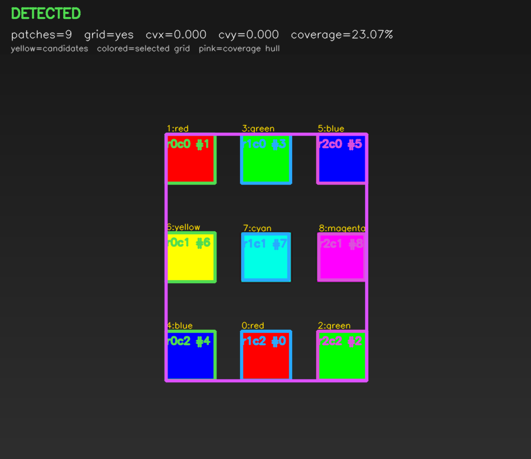
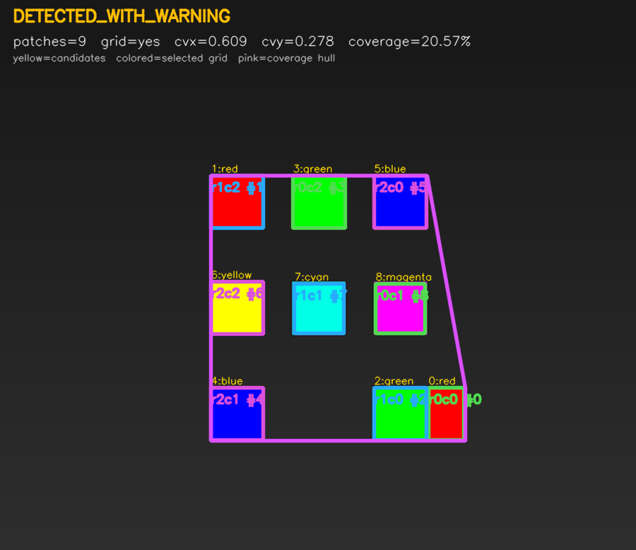
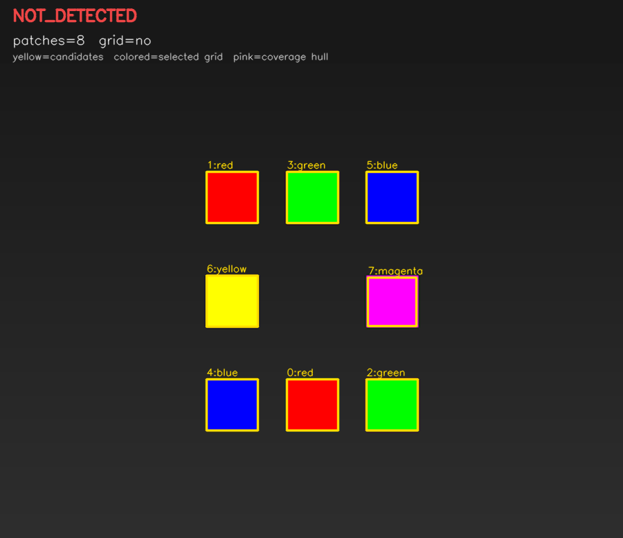

# Marker Coverage Estimator

[](https://github.com/guy2610/marker-coverage-estimator/actions/workflows/ci.yml)


A deterministic C++17/OpenCV pipeline that detects a colored 3×3 marker,
validates its geometry, and estimates how much of an image it covers.

The project includes a reusable core library, command-line interface, synthetic
dataset generator, annotated diagnostics, automated tests, and Linux CI.

## Visual diagnostics

| Detected | Detected with warning | Not detected |
|---|---|---|
|  |  |  |
| Regular synthetic 3×3 marker. | One displaced cell passes tolerant, but not strict, geometry. | Eight detected patches cannot fill the complete grid. |

Visualization legend:

- thin yellow boxes: segmentation candidates;
- thick colored boxes: the selected grid;
- `rNcM` labels: assigned row and column;
- pink outline: the coverage convex hull.

## Dataset provenance

The original implementation was developed and evaluated on 20 real-world
images containing substantial color clutter and false-positive candidates.
Those images are not redistributed in this repository.

The public repository instead generates synthetic images for reproducible
tests, examples, diagnostics, and coverage ground truth. The synthetic set is
not claimed to reproduce the full difficulty or visual distribution of the
private real-world evaluation set.

See [docs/DATASET.md](docs/DATASET.md) for the complete data policy.

## Detection and coverage are separate

The detector answers two different questions:

1. Do the selected patches form a plausible 3×3 marker?
2. What percentage of the image does the selected marker cover?

A small, geometrically regular marker can therefore be detected even when its
coverage is low.

## Detection statuses

- `DETECTED` — strict spacing validation passed.
- `DETECTED_WITH_WARNING` — tolerant, but not strict, spacing passed.
- `NOT_DETECTED` — assignment or geometry validation failed.

Coverage is reported for both successful states.

## Processing pipeline

```text
BGR image
   │
   ▼
HSV color segmentation
   │
   ▼
Contour and relative-area filtering
   │
   ▼
PCA rotation normalization
   │
   ▼
Deterministic row/column K-means
   │
   ▼
Greedy assignment to a 3×3 grid
   │
   ├── spacing validation ──► detection status
   │
   └── convex hull ─────────► image coverage
```

See [ALGORITHM.md](ALGORITHM.md) for the detailed implementation and
[docs/DETECTION_MODEL.md](docs/DETECTION_MODEL.md) for status semantics.

## Build

### Requirements

- CMake 3.16 or newer
- C++17 compiler
- OpenCV 4
- Python 3 when building tests

### Ubuntu

```bash
sudo apt-get update
sudo apt-get install --yes \
  cmake \
  g++ \
  libopencv-dev \
  ninja-build

cmake \
  -S . \
  -B build \
  -G Ninja \
  -DCMAKE_BUILD_TYPE=Release \
  -DBUILD_TESTING=ON

cmake --build build --parallel
```

### macOS with Homebrew

```bash
brew install cmake opencv@4

cmake \
  -S . \
  -B build \
  -DCMAKE_BUILD_TYPE=Release \
  -DBUILD_TESTING=ON \
  -DOpenCV_DIR="$(brew --prefix opencv@4)/lib/cmake/opencv4"

cmake --build build --parallel
```

## Generate public sample data

```bash
./build/generate-synthetic-dataset \
  output/synthetic
```

Generated output:

```text
output/synthetic/
├── images/
├── manifest.csv
└── contact_sheet.png
```

The manifest records intended scenario labels and polygon-based ground-truth
coverage.

## Usage

```bash
./build/marker-coverage \
  output/synthetic/images/clean_centered.png \
  output/synthetic/images/irregular_spacing.png
```

Example output:

```text
output/synthetic/images/clean_centered.png marker_found coverage=23.1%
output/synthetic/images/irregular_spacing.png marker_found coverage=20.6% warning=IRREGULAR_SPACING

Summary: detected=1 warnings=1 not_detected=0 out of 2
```

Generate annotated images:

```bash
./build/marker-coverage \
  --debug \
  --visualize-dir output/annotated \
  output/synthetic/images/clean_centered.png
```

Show all options:

```bash
./build/marker-coverage --help
```

## Public synthetic scenarios

### Stable regression cases

| Scenario | Expected behavior |
|---|---|
| Centered marker | Detected |
| Small marker | Detected with low reported coverage |
| Rotation `+20°` | Detected |
| Rotation `-28°` | Detected |
| Controlled perspective | Detected |
| Irregular spacing | Detected with warning |
| Missing center patch | Not detected |
| Blank image | Not detected |

### Challenge cases

The generator also creates:

- lower-contrast blur and noise;
- additional colored distractors.

These currently expose known weaknesses in segmentation and candidate
assignment. They are generated for development, but are not required to pass
the stable regression suite.

## Tests

```bash
ctest \
  --test-dir build \
  --output-on-failure
```

The test suite includes:

- native C++ core tests;
- runtime generation of synthetic input images;
- CLI classification tests;
- low-coverage reporting;
- repeated-run determinism;
- batch-order independence;
- visualization generation.

The same suite runs automatically on Ubuntu through GitHub Actions.

See [docs/TESTING.md](docs/TESTING.md) for details.

## Project structure

```text
.
├── CMakeLists.txt
├── include/                 Public C++ interfaces
├── src/                     Core pipeline, CLI and visualization
├── tools/                   Synthetic dataset generator
├── tests/                   C++ and Python tests
├── docs/
│   ├── DATASET.md
│   ├── DETECTION_MODEL.md
│   ├── TESTING.md
│   └── images/              Synthetic README examples
└── .github/workflows/       Linux continuous integration
```

## Known limitations

- Fixed HSV thresholds are sensitive to lighting and color variation.
- False-positive patches influence PCA and K-means.
- All segmentation candidates participate in clustering.
- Final grid selection uses greedy assignment.
- One incorrect patch can distort spacing and the coverage hull.
- Coverage uses axis-aligned contour bounding boxes.
- Perspective is not explicitly rectified with a homography.
- The expected marker color arrangement is not validated.
- Spacing thresholds are heuristic.
- The public synthetic set is not an accuracy benchmark.
